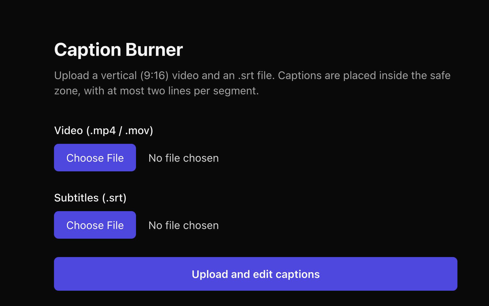

# Caption Burner

[](https://nextjs.org/)
[](https://react.dev/)
[](https://www.typescriptlang.org/)
[](https://ffmpeg.org/)


A focused web app for generating, editing, and burning captions directly into MP4 videos. Vertical videos get a live safe-zone preview designed for **Instagram Reels**, **TikTok**, and **YouTube Shorts**; horizontal long-form videos get their own caption layout. Generate captions automatically from the audio with [Whisper](https://huggingface.co/openai/whisper-small), or upload an existing SRT or WebVTT file with your video.



## Features

- **Automatic Captions** - Generate timed, word-synced captions from the audio with Whisper (`whisper-small`). The spoken language is detected automatically, so you only upload the video
- **Video and Caption Upload** - Import an MP4, MOV, or WebM video. Choose automatic captions (the default) or upload an SRT/VTT file up to 2 MB. Uploaded captions keep their text and timing and skip automatic transcription, with both local and Azure uploads supported
- **Find and Replace** - Fix names and terms across every caption at once, with match case and whole-word options. Word-by-word timing is kept, and the change can be undone
- **Clean Up Pauses and Fillers** - Shorten long pauses (found in the audio) and remove hesitations ("hum", "uh", "ahn"), optional filler words, or your own list. The preview skips the cuts, and captions shift to the shorter video
- **Export Options** - Burned-in captions, or **soft subtitles**: a selectable subtitle track inside the MP4 that does not re-encode the video unless you made cuts. Captions can also be downloaded as SRT or VTT
- **Live Preview** - See each caption over the video at its exact timestamp
- **Segment Editor** - Update subtitle text, start time, and end time independently
- **Smart Line Breaks** - Balance caption text across two lines at the nearest word boundary
- **Time Splitting** - Divide long captions into two consecutive timed segments
- **Merge and Group** - Join a caption with the next one, or group word-by-word captions into readable phrases
- **Safe-Zone Validation** - Detect empty text, overlapping timestamps, invalid durations, and overflow
- **Automatic Format Detection** - Classify every video by aspect ratio (and rotation) as social or long-form. Each format has its own font scale, line length, caption box, vertical position, and safe zone
- **Caption Styling and Brand Presets** - Bundled fonts (Inter, Montserrat, Cascadia Code, JetBrains Mono) plus system fonts, and seven presets in one list, including VS Code Blue, Dark+ Editor (Cascadia Code), and Insiders Green. The VS Code colors, taken from code.visualstudio.com and the official logos, live in `lib/vscode-brand.ts`
- **Burned-In Captions** - Render styled subtitles into an H.264 MP4 with FFmpeg
- **Render Progress** - Follow processing status and download the completed video
- **Automatic Cleanup** - Delete source files after rendering and output files after download

## Usage

1. Select an MP4, MOV, or WebM video, vertical or horizontal.
2. Choose **Generate automatically** to detect the spoken language and transcribe the audio, or **Upload SRT or VTT** and select your caption file (up to 2 MB).
3. Choose **Open review workspace**. Automatic mode shows transcription progress in the editor; uploaded captions are ready for review without transcription.
4. Select a segment to preview and edit its text or timing.
5. Use **Break line** or **Split in time** when a caption needs adjustment.
6. Resolve any highlighted validation errors.
7. Optionally open **Clean up** to remove pauses and fillers, and use **Find and replace** in the Captions panel to fix terms. Audio pause detection is available for automatically transcribed captions.
8. Pick **Burned-in captions** or **Soft subtitles**, choose **Export**, then download the completed MP4.

## Caption Rules

| Rule | Limit |
|---|---|
| Video size | 600 MB maximum |
| Video duration | 10 minutes maximum |
| Caption upload | SRT or VTT, 2 MB maximum |
| Caption lines | 2 per segment |

| Format | Detected when | Reference width | Line length | Caption box |
|---|---|---|---|---|
| Social | width / height < 1.2 (9:16, 4:5, 1:1) | 1080 px | 34 characters | Fills the safe zone |
| Long-form | width / height ≥ 1.2 (16:9, 4:3) | 1920 px | 42 characters | Wraps around the text |

Font sizes are authored against the reference width and scale with the video, so a 1080p horizontal video and a 1080×1920 vertical video look equally proportioned. Captions are rendered in white over a dark box near the bottom of the frame. The social layout reserves space for platform interface elements at the top, bottom, and right side of the video; the long-form layout keeps captions inside title-safe margins.

## Requirements

- Node.js 20.9 or later
- npm
- FFmpeg and ffprobe available on your `PATH`
- About 300 MB of disk for the Whisper model, downloaded on the first transcription into `.cache/whisper` (override with `WHISPER_CACHE_DIR`)

On macOS, install FFmpeg with Homebrew:

```bash
brew install ffmpeg
```

Verify the installation:

```bash
ffmpeg -version
ffprobe -version
```

## Installation

Clone the repository and install the dependencies:

```bash
git clone https://github.com/cyz/captions.git
cd captions
npm install
```

Run the development server:

```bash
npm run dev
```

Open [http://localhost:3000](http://localhost:3000) in your browser.

## Production

Create and run an optimized production build:

```bash
npm run build
npm start
```

## Architecture

The application uses the Next.js App Router and Node.js route handlers. Local development stores files and metadata under `data/jobs/<jobId>`, which is intentionally excluded from Git.

```text
Video upload
	|
	v
ffprobe inspection -> format detection (social / long-form)
	|
	v
FFmpeg audio -> Whisper (language + word timestamps) -> captions
	|
	v
Caption editing and safe-zone preview
	|
	v
Canvas PNG overlays -> FFmpeg composition -> MP4 download
```

Key directories:

```text
app/          Pages and API route handlers
public/fonts/ Bundled caption fonts (SIL Open Font License, see the LICENSE files there)
components/   Reusable interface components
lib/          SRT/VTT, format profiles, safe-zone, Whisper transcription, silence and filler cleanup, cuts, storage, queue, canvas, and FFmpeg logic
data/         Local runtime files (not committed)
worker/       Single-execution Azure render and transcription worker
infra/        Azure Bicep template and deployment script
```

### Azure Architecture

The production deployment minimizes idle consumption:

```text
Browser -> scale-to-zero Container App -> Table Storage
	|                 |
	|                 +-> Queue Storage -> Container Apps Job
	|                                        |
	+---- signed Blob upload ----------------+
														  |
								 Blob input -> FFmpeg -> Blob output
```

- Videos upload directly from the browser to private Blob Storage using a short-lived SAS.
- Job metadata and caption segments are stored in Table Storage.
- Queue Storage triggers one FFmpeg Container Apps Job execution at a time.
- A second queue and Container Apps Job (`WORKER_QUEUE=transcribe`) runs Whisper
  speech-to-text, so renders stay cheap.
- The web app uses `0.25` vCPU and `0.5 GiB`, with zero minimum replicas.
- The render job uses `1` vCPU and `2 GiB` only while processing.
- The transcription job uses `2` vCPU and `4 GiB` only while processing. Measure
  transcription time on your own videos before changing these values.
- The Whisper model is baked into the container image (`WHISPER_OFFLINE=1`), so
  jobs never download it at run time. Set `WHISPER_MODEL` or `WHISPER_DTYPE` at
  build time to use a different ONNX Whisper model or precision.
- Managed identities grant the web app and worker access to Storage.
- The app deletes input blobs after a successful render and deletes the output
  after its first completed download.
- Lifecycle policies remain as a fallback, deleting orphaned inputs after one
  day and outputs after seven days.

### API Routes

| Route | Purpose |
|---|---|
| `POST /api/upload` | Store the video and create a processing job (an `srt` field is still accepted by the API) |
| `POST /api/transcribe/:jobId` | Queue Whisper transcription (`{"replace": true}` overwrites existing captions) |
| `GET /api/segments/:jobId` | Load video metadata, subtitle segments, and transcription state |
| `PUT /api/segments/:jobId` | Save edited subtitle segments, style, and cuts |
| `GET /api/preview/:jobId` | Stream the source video to the editor |
| `POST /api/render/:jobId` | Queue the export (`{"mode": "burned" \| "soft"}`) |
| `GET /api/status/:jobId` | Report rendering and transcription status and progress |
| `GET /api/download/:jobId` | Download the rendered MP4 |

## Deployment Notes

The local backend requires a Node.js server with:

- FFmpeg and ffprobe installed
- A writable, persistent filesystem for the `data` directory
- Enough memory and execution time to process uploaded videos

GitHub Pages cannot run this application because it only serves static files. The Azure deployment uses persistent object storage and a background worker instead of relying on a server filesystem.

### Azure

The included deployment targets the `devtools` subscription in the `Advocates at DevRel 2611` tenant. It stores the private image in an Azure Container Registry Basic instance.

1. Authenticate Azure CLI.
2. Deploy the registry, image, and application infrastructure:

```bash
./infra/deploy.sh
```

The script refuses to deploy if the active subscription does not belong to the expected tenant. It builds and deploys an immutable image tag derived from the latest application commit. Container Apps pulls the image through a dedicated managed identity, so registry passwords are not enabled or stored.

Pushes to the `main` branch automatically run `.github/workflows/deploy-azure.yml`.
The workflow authenticates with Azure through GitHub OIDC, builds an image tagged
with the pushed commit SHA, and updates the Container App and render job. The
repository must define the `AZURE_CLIENT_ID`, `AZURE_SUBSCRIPTION_ID`, and
`AZURE_TENANT_ID` GitHub Actions variables.

### Netlify

Netlify can deploy the interface and Next.js route handlers, but the current video-processing backend is not compatible with its serverless runtime. Upload and rendering require persistent storage, FFmpeg and ffprobe binaries, and a worker that continues running after the API response. Use a persistent Node.js or container host, or move storage and rendering to dedicated external services before using Netlify in production.

## Available Scripts

- `npm run dev` starts the development server
- `npm run build` creates a production build
- `npm start` runs the production server
- `npm run worker` processes one Azure Queue message and exits
- `npm run check` runs the TypeScript compiler without emitting files
- `npm test` runs the unit tests (format detection, line wrapping, segmentation, find and replace, cuts, cleanup)
